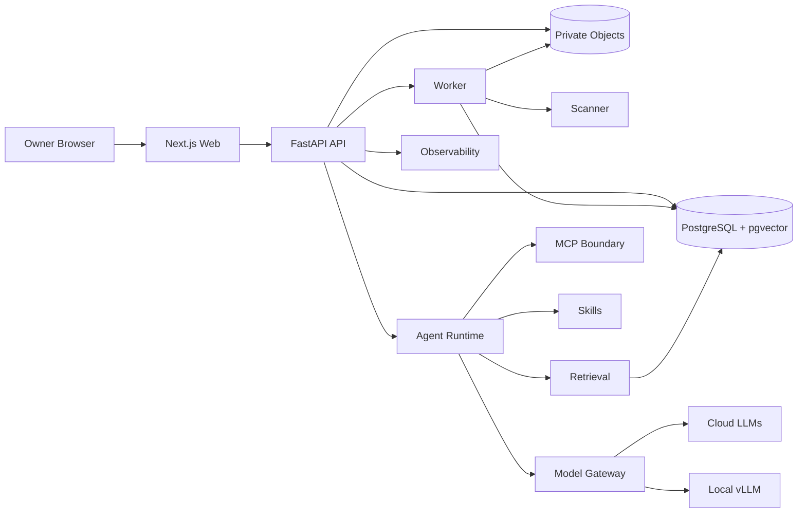
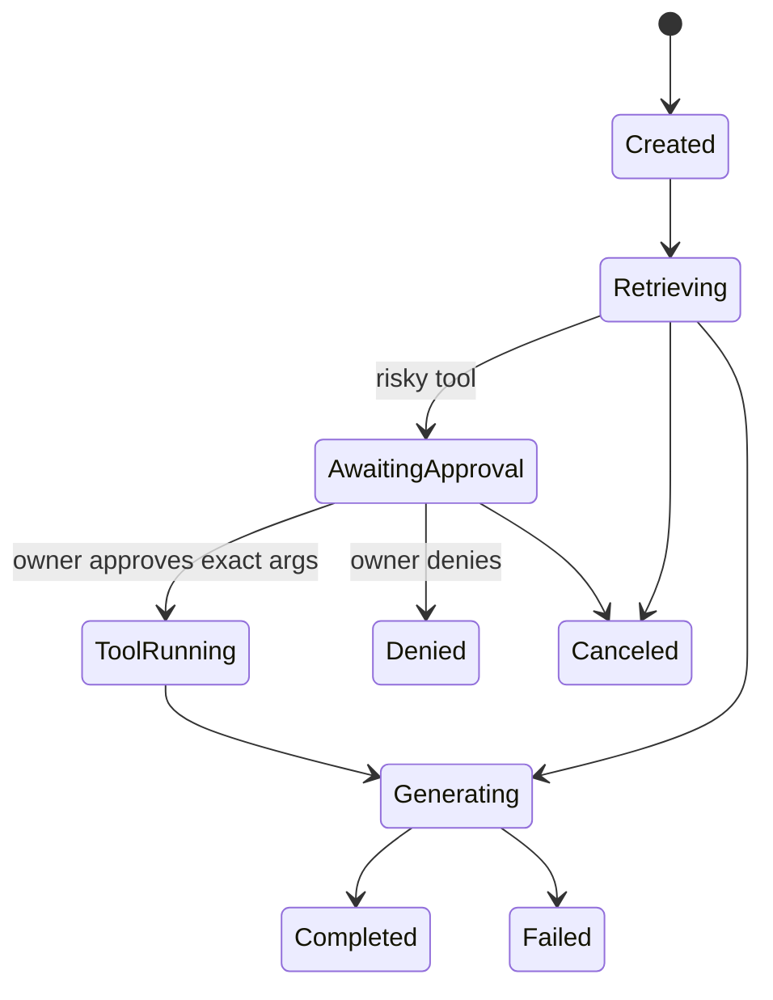
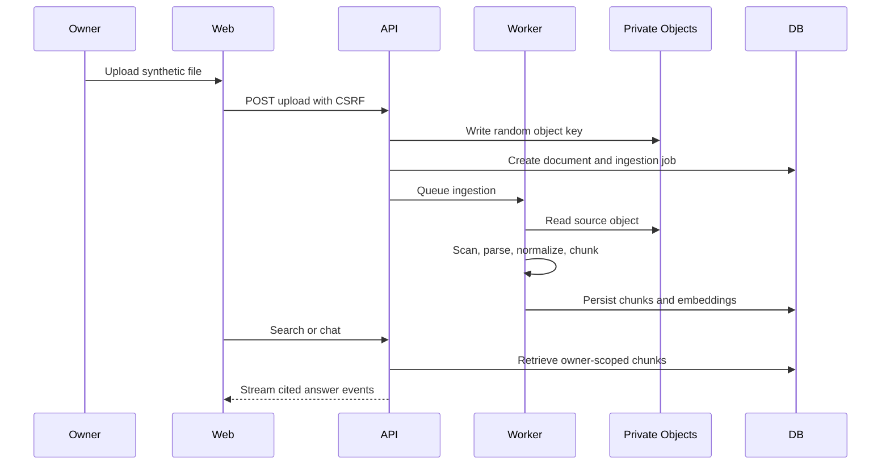

# Loomi-Brain

Owner-only AI second brain for private knowledge ingestion, hybrid retrieval, cited chat, controlled agent runs, MCP integrations, observability, deterministic evaluation, and declarative skills.

Loomi-Brain is built as a portfolio-grade full-stack AI platform: a Next.js web app, FastAPI API, background worker, PostgreSQL with pgvector, private object storage, provider-neutral model gateway, approval-gated tools, and safety-first MCP/skill boundaries. The default demo uses synthetic data and mock model output, so reviewers can run the system without paid provider keys or personal documents.

## What It Shows

- Single-owner authentication with server-side sessions, HttpOnly SameSite cookies, CSRF protection, session revocation, and no public registration.
- Private document ingestion with size limits, MIME validation, safe filenames, parser limits, fake/local scanner mode, chunk provenance, deterministic embeddings, and complete document deletion.
- Lexical, semantic, and hybrid search with reciprocal rank fusion.
- Streamed cited chat with provider adapters, citation validation, no-answer behavior, cancellation, and owner feedback.
- Controlled agent runtime with explicit states, tool allowlists, approval binding, audit history, cancellation, and a run inspector.
- MCP registry with deny-by-default capability discovery, schema-hash-bound approvals, stdio templates, and safe Streamable HTTP validation.
- Declarative skills with strict manifests, immutable published versions, template restrictions, dry-run previews, deterministic tests, and runtime policy intersection.
- Privacy-safe observability and deterministic evaluation in CI/local mode.
- Hardened local Docker profile plus cloud and private/hybrid deployment references.

## Architecture







## Quick Start

Requirements: Docker, Docker Compose, Node 22.13+ through Corepack, `uv`, and GNU Make.

```bash
cp .env.example .env
make setup
docker compose -f infra/docker/compose.yml up --build -d postgres redis api worker web
```

Open `http://127.0.0.1:3000`.

Development-only owner credentials:

```text
Email: owner@loomi.local
Password: loomi-local-owner-password
```

Production rejects the default local password, insecure cookies, wildcard CORS, wildcard trusted hosts, disabled scanner policy, excessive telemetry sampling, telemetry content capture, and private-network MCP egress.

## Synthetic Demo Path

1. Sign in with the development-only owner.
2. Open Knowledge and upload synthetic Markdown, text, CSV, PDF, or image files.
3. Search in lexical, semantic, and hybrid modes.
4. Ask a cited question in Chat and inspect the streamed answer.
5. Open Runs and review agent state, tool policy, usage, and approvals.
6. Open MCP, register the built-in harmless test server, enable an exact tool, and invoke it.
7. Open Skills, create a draft skill, run a deterministic test, publish it, and execute it through the runtime.
8. Open Observability and review sanitized spans, retrieval diagnostics, feedback, and evaluation status.
9. Run deterministic evaluation:

```bash
make eval
```

## Deployment Profiles

Local:

```bash
docker compose -f infra/docker/compose.yml up --build -d postgres redis api worker web
docker compose -f infra/docker/compose.yml --profile observability up -d observability
docker compose -f infra/docker/compose.yml --profile storage up -d object-store
docker compose -f infra/docker/compose.yml --profile scan up -d clamav
```

Local LLM profiles are documented in the local deployment guide. They cover CPU-only mock/demo mode, low-VRAM OpenAI-compatible endpoints, moderate-VRAM vLLM, and the limits reviewers should verify on their own hardware.

Cloud:

- Frontend on Vercel.
- API and worker on a long-running container platform, not Vercel serverless functions.
- Neon PostgreSQL with pgvector and pooling constraints documented.
- Private S3-compatible object storage.
- Server-side provider keys only.
- Owner-only auth, strict CORS/trusted hosts, secure cookies, TLS, health checks, backups, rollback, and retention.

Private/hybrid:

- Full stack on a private machine reachable over Tailscale or equivalent private networking.
- Optional cloud web/API plus local inference only through a tightly controlled private connector. vLLM is never exposed directly to the public internet.

## Verification

```bash
corepack pnpm format:check
make lint
make typecheck
make test
make security
make eval
corepack pnpm build
docker compose -f infra/docker/compose.yml config
docker compose -f infra/docker/compose.yml build api worker web
```

Additional GitHub workflows cover CodeQL, dependency updates, filesystem/container vulnerability scans, secret/config scanning, SBOM artifacts, and manual release packaging without production deployment.

## Operations

Back up development data:

```bash
scripts/backup-postgres.sh
scripts/backup-objects.sh
scripts/disaster-recovery-smoke.sh
```

Restore and deletion scripts require explicit confirmation environment variables and are intended for local/test environments unless an operator adapts them for a managed platform.

## Documentation

- [Architecture](docs/architecture.md)
- [Threat model](docs/threat-model.md)
- [Local deployment](docs/local-deployment.md)
- [Cloud deployment](docs/cloud-configuration.md)
- [Private and hybrid deployment](docs/private-hybrid-deployment.md)
- [Operations runbook](docs/operations-runbook.md)
- [Backup and restore](docs/backup-restore.md)
- [Incident response](docs/incident-response.md)
- [Demo walkthrough](docs/demo-walkthrough.md)
- [Evaluation and performance](docs/performance-report.md)
- [MCP security](docs/mcp-security.md)
- [Skills](docs/skills.md)
- [ADR index](docs/adr-index.md)
- [Data privacy](docs/data-privacy.md)
- [Release checklist](docs/release-checklist.md)

## Screenshots To Capture

Use synthetic data only:

- Knowledge Library with one uploaded prompt-injection fixture and one benign project note.
- Hybrid Search showing lexical/semantic/hybrid comparison.
- Cited Chat with source chips and validated citations.
- Agent Run Inspector paused at a harmless approval.
- MCP Console with the built-in test server and exact enabled tools.
- Skill Editor showing a deterministic test result.
- Observability dashboard with sanitized spans and evaluation status.

## Security Model

All document text, retrieved context, model output, MCP metadata, MCP tool output, and skill manifests are untrusted. Provider keys never go to the browser. Tool execution is server-side, allowlisted, approval-gated when risky, and bound to exact canonical arguments. Skills cannot install packages, execute shell/Python/JavaScript, or grant undeclared tools. MCP remote endpoints block private-network egress by default.

Residual risks are documented in the threat model and release checklist. The largest remaining items are a production-grade distributed rate limiter, stronger worker job durability, live cloud deployment verification, browser E2E/a11y tests, and managed backup restore rehearsal.

## Contributing

This project is owner-led. Contributions should include tests, update relevant docs, avoid real personal data, and preserve the owner-only security boundary.

## License

Apache-2.0.
