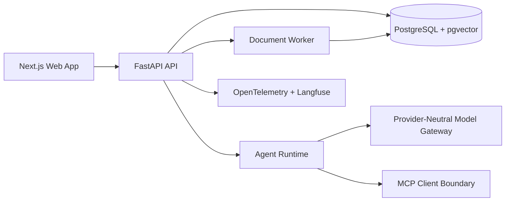

# Loomi-Brain

Secure, single-owner second-brain application for private knowledge ingestion, retrieval, cited chat, controlled agent tooling, MCP integrations, observability, evaluation, and declarative skills.

This repository is in Phase 0: discovery and design. The product, architecture, threat model, and implementation plan are written before feature implementation so the first code slices have a clear target.

## Current State

- Repository initialized from an empty workspace.
- No application code has been implemented yet.
- Required Phase 0 documentation exists.
- Dependency choices are recorded as a dated baseline and must be locked before implementation claims are made.
- Local tooling check found Node.js, npm, Corepack, uv, Docker, and Make available; pnpm is not installed directly, and the local Python is older than the target runtime.

## Documentation

- [Product requirements](docs/product-requirements.md)
- [Architecture](docs/architecture.md)
- [Threat model](docs/threat-model.md)
- [Implementation plan](docs/implementation-plan.md)
- [Assumptions](docs/assumptions.md)
- [Architecture decisions](docs/decisions)

## Planned Architecture

## Phase Checklist

1. Discovery and design.
2. Foundation.
3. Knowledge ingestion.
4. Search and cited chat.
5. Agent runtime.
6. Observability and evaluation.
7. MCP integration.
8. Skills system.
9. Deployment and hardening.

See the implementation plan for acceptance criteria and verification commands.

## Security Posture

Loomi-Brain treats uploaded content, retrieved passages, imported web pages, MCP metadata, MCP responses, tool output, model output, and skill manifests as untrusted data. Provider secrets remain server-side only. Owner authorization is enforced in the API and service layers, not only in the frontend.

## Demo Data

The project will use synthetic documents only:

- research notes
- meeting notes
- project notes
- a small CSV
- a document containing an obvious prompt-injection attempt
- expected questions and retrieval evidence

## License

The recommended project license is MIT, with dependency license notices maintained as part of the hardening phase. Some candidate runtime dependencies may use non-MIT licenses and must be documented before release.
