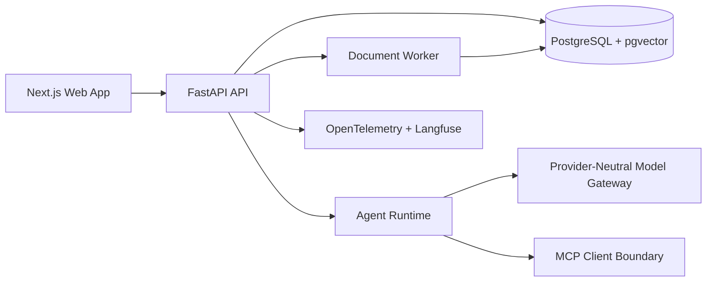

# Loomi-Brain

Secure, single-owner second-brain application for private knowledge ingestion, retrieval, cited chat, controlled agent tooling, MCP integrations, observability, evaluation, and declarative skills.

This repository is in Phase 1: foundation. The initial monorepo, API, worker, web shell, owner auth boundary, migrations, Docker Compose stack, CI workflow, and local verification commands are in place.

## Current State

- Repository initialized from an empty workspace.
- Next.js web app shell renders the owner workspace dashboard.
- FastAPI exposes health, session, and document-list endpoints.
- SQLAlchemy and Alembic define the Phase 1 base schema.
- Local owner authentication uses server-side sessions, HttpOnly SameSite cookies, CSRF tokens, and session revocation.
- Docker Compose defines PostgreSQL with pgvector, Redis, API, worker, web, and optional storage, scan, and observability profiles.
- CI is configured for frozen installs, formatting, linting, type checks, tests, build, migration verification, security checks, dependency audit, and container builds.

## Local Development

Install dependencies from lockfiles:

```bash
make setup
```

Start the local Docker stack in the background:

```bash
make dev
```

The default host ports are `3000` for web, `8000` for API, `15432` for PostgreSQL, and `16379` for Redis.

Apply migrations and seed the local owner when running services outside Docker:

```bash
make migrate
make seed
```

Local owner credentials are intentionally development-only:

```text
Email: owner@loomi.local
Password: loomi-local-owner-password
```

Production rejects the default local password and insecure cookie settings.

## Verification

Run the Phase 1 gate:

```bash
make format
make lint
make typecheck
make test
make security
corepack pnpm build
docker compose -f infra/docker/compose.yml config
```

## Documentation

- [Product requirements](docs/product-requirements.md)
- [Architecture](docs/architecture.md)
- [Threat model](docs/threat-model.md)
- [Implementation plan](docs/implementation-plan.md)
- [Assumptions](docs/assumptions.md)
- [Architecture decisions](docs/decisions)

## Planned Architecture



## Phase Checklist

1. Discovery and design: complete.
2. Foundation: implemented.
3. Knowledge ingestion.
4. Search and cited chat.
5. Agent runtime.
6. Observability and evaluation.
7. MCP integration.
8. Skills system.
9. Deployment and hardening.

See the implementation plan for acceptance criteria and verification commands.

## Security Posture

Loomi-Brain treats uploaded content, retrieved passages, imported web pages, MCP metadata, MCP responses, tool output, model output, and skill manifests as untrusted data. Provider secrets remain server-side only. Owner authorization is enforced in the API and service layers, not only in the frontend.

## Demo Data

The project will use synthetic documents only:

- research notes
- meeting notes
- project notes
- a small CSV
- a document containing an obvious prompt-injection attempt
- expected questions and retrieval evidence

## License

The recommended project license is MIT, with dependency license notices maintained as part of the hardening phase. Some candidate runtime dependencies may use non-MIT licenses and must be documented before release.
