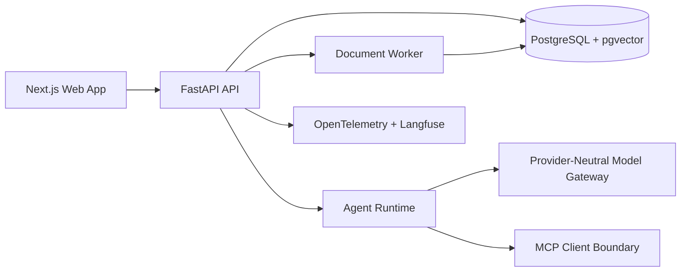

# Loomi-Brain

Secure, single-owner second-brain application for private knowledge ingestion, retrieval, cited chat, controlled agent tooling, MCP integrations, observability, evaluation, and declarative skills.

This repository is in Phase 6: secure MCP client integration. The monorepo foundation, owner auth boundary, document upload pipeline, retrieval services, provider-neutral chat gateway, citation validation, controlled agent runtime, Observability UI, MCP registry/tool-policy UI, migrations, Docker Compose stack, CI workflow, and local verification commands are in place.

## Current State

- Repository initialized from an empty workspace.
- Next.js renders the owner dashboard, Knowledge Library at `/knowledge`, search page at `/search`, cited chat workspace at `/chat`, Agent Run Inspector at `/runs`, MCP console at `/mcp`, and Observability dashboard at `/observability`.
- FastAPI exposes health, session, document, upload, preview, retry, re-index, delete, tag, ingestion-job, search, conversation, streamed response, cancellation, source, provider, feedback, agent-run, MCP, and observability endpoints under `/api/v1`.
- SQLAlchemy and Alembic define the Phase 1 base schema plus Phase 2 ingestion metadata and Phase 3 retrieval indexes.
- Local owner authentication uses server-side sessions, HttpOnly SameSite cookies, CSRF tokens, and session revocation.
- Document ingestion streams uploads to private storage, validates MIME, scans, extracts text, normalizes, chunks, embeds with a deterministic fake provider, persists provenance, and exposes safe previews.
- Search supports lexical, semantic, and hybrid modes. Hybrid retrieval uses reciprocal rank fusion over lexical and vector rankings.
- Cited chat streams typed SSE events, validates citations against selected chunks, persists conversations/messages/runs/events, and supports cancellation, retry, source preview, provider metadata, and owner feedback.
- Agent runs use a code-owned state machine, per-run tool allowlists, safe first-party tools, approval-required local mutation tooling, exact argument-hash approval binding, cancellation, retry, persisted event history, and a run-inspector UI.
- MCP integration supports owner-approved stdio templates, Streamable HTTP validation, sanitized capability discovery, deny-by-default tools, schema-hash approval binding, dynamic agent-runtime tool IDs, audit history, and a harmless built-in test server.
- Privacy-safe telemetry records sanitized spans for API requests, retrieval, model calls, agent states, tools, approvals, ingestion stages, owner feedback, and deterministic evaluations.
- Docker Compose defines PostgreSQL with pgvector, Redis, API, worker, web, and optional storage, scan, and observability profiles.
- CI is configured for frozen installs, formatting, linting, type checks, tests, build, migration verification, security checks, dependency audit, and container builds.

## Local Development

Install dependencies from lockfiles:

```bash
make setup
```

Start the local Docker stack in the background:

```bash
make dev
```

The default host ports are `3000` for web, `8000` for API, `15432` for PostgreSQL, and `16379` for Redis.

Apply migrations and seed the local owner when running services outside Docker:

```bash
make migrate
make seed
```

Local owner credentials are intentionally development-only:

```text
Email: owner@loomi.local
Password: loomi-local-owner-password
```

Production rejects the default local password and insecure cookie settings.

Open the Knowledge Library at `http://127.0.0.1:3000/knowledge`, sign in with the local owner credentials, then upload synthetic documents. Use `/search` to compare retrieval modes, `/chat` to ask grounded questions with citations, `/runs` to start and inspect controlled agent runs, `/mcp` to register the harmless test MCP server and enable exact tools, and `/observability` to inspect sanitized product telemetry. Supported default-local formats are PDF, DOCX, PPTX, Markdown, text, HTML, CSV, PNG, JPEG, TIFF, and WEBP. URL ingestion is intentionally deferred until SSRF protections are implemented.

Default limits are 15 MiB per uploaded file, 8 files per request, 80 PDF pages, 24 million image pixels, 250,000 extracted characters, 500 chunks per document, and bounded Office archive entry/uncompressed-size limits. Local/test mode uses a fake scanner and deterministic fake embeddings; production requires scanner availability.

## Verification

Run the Phase 6 gate:

```bash
make format
make lint
make typecheck
make test
make security
corepack pnpm build
corepack pnpm format:check
corepack pnpm peers check
docker compose -f infra/docker/compose.yml config
make eval
```

Optional Docling extraction is pinned as an API extra and can be installed for local experiments:

```bash
cd apps/api
uv sync --extra docling
LOOMI_EXTRACTION_ENGINE=docling uv run fastapi dev src/loomi_api/main.py
```

## Documentation

- [Product requirements](docs/product-requirements.md)
- [Architecture](docs/architecture.md)
- [Threat model](docs/threat-model.md)
- [Implementation plan](docs/implementation-plan.md)
- [Model providers](docs/model-providers.md)
- [Agent runtime](docs/agent-runtime.md)
- [Observability](docs/observability.md)
- [MCP security](docs/mcp-security.md)
- [Approval policy](docs/approval-policy.md)
- [Tool development](docs/tool-development.md)
- [Evaluation](docs/evaluation.md)
- [Cloud configuration](docs/cloud-configuration.md)
- [Data privacy](docs/data-privacy.md)
- [Local deployment](docs/local-deployment.md)
- [Assumptions](docs/assumptions.md)
- [Architecture decisions](docs/decisions)

## Planned Architecture



## Phase Checklist

- [x] Phase 0: Discovery and design.
- [x] Phase 1: Foundation.
- [x] Phase 2: Knowledge ingestion.
- [x] Phase 3: Search and cited chat.
- [x] Phase 4: Agent runtime.
- [x] Phase 5: Observability and evaluation.
- [x] Phase 6: MCP integration.
- [ ] Phase 7: Skills system.
- [ ] Phase 8: Deployment and hardening.

See the implementation plan for acceptance criteria and verification commands.

## Security Posture

Loomi-Brain treats uploaded content, extracted text, previews, retrieved passages, imported web pages, MCP metadata, MCP responses, tool metadata, tool output, model output, and skill manifests as untrusted data. Provider secrets remain server-side only. Owner authorization is enforced in the API and service layers, not only in the frontend. Uploaded source objects are stored outside static paths and are deleted with their derived chunks and embeddings. Model citations are accepted only when they reference selected stored chunks. Tool execution is server-side, allowlisted per run, and approval-gated for risky actions.

## Demo Data

The project will use synthetic documents only:

- research notes
- meeting notes
- project notes
- a small CSV with formula-like cells
- a document containing an obvious prompt-injection attempt
- expected questions and retrieval evidence

## License

The recommended project license is MIT, with dependency license notices maintained as part of the hardening phase. Some candidate runtime dependencies may use non-MIT licenses and must be documented before release.
