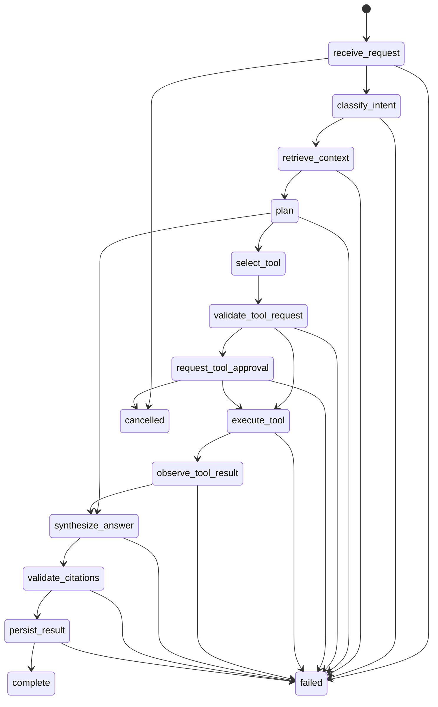

# Agent Runtime

Phase 4 implements a provider-neutral, bounded runtime under
`apps/api/src/loomi_api/agent_runtime`.

## State Machine

Runs persist one current state on `agent_runs.state` and append every transition to
`agent_events`.

Terminal states are `complete`, `cancelled`, and `failed`.

## Controls

- Deterministic run IDs are used when callers supply an idempotency key.
- Limits include max steps, max tool calls, request timeout metadata, per-step timeout,
  token budget, cost budget, and retry budget.
- Tool calls are deduplicated by run ID, tool ID, and canonical argument hash.
- Sensitive tool calls pause at `request_tool_approval`.
- Approval records bind owner ID, run ID, tool call ID, tool ID, risk class, expiration,
  and canonical argument hash.
- Approval is single-use; changed approval arguments expire the approval and fail the run.
- Cancellation is persisted and terminal.
- All event payloads are sanitized before persistence.

## API

The API surface is under `/api/v1/agent-runs`:

- `POST /api/v1/agent-runs`
- `GET /api/v1/agent-runs`
- `GET /api/v1/agent-runs/{run_id}`
- `GET /api/v1/agent-runs/{run_id}/events`
- `GET /api/v1/agent-runs/{run_id}/stream`
- `POST /api/v1/agent-runs/{run_id}/cancel`
- `POST /api/v1/agent-runs/{run_id}/retry`
- `POST /api/v1/agent-runs/{run_id}/approvals/{approval_id}/approve`
- `POST /api/v1/agent-runs/{run_id}/approvals/{approval_id}/deny`

Mutations require the owner session and CSRF token.

## UI

The Agent Run Inspector lives at `/runs`. It supports owner login, run creation, state
filtering, timeline inspection, tool cards, approval cards, usage/cost/latency display,
cancel, retry, approve, and deny.

## Limitations

- The deterministic runtime uses rule-based planning for Phase 4 acceptance tests.
- `notes.create_draft` stages a draft in the tool-call result only; a durable notes table
  can replace this in a later product slice.
- Recovery after restart is practical through persisted event history, pending approval
  records, and retry of failed runs, but there is no background resume worker yet.
