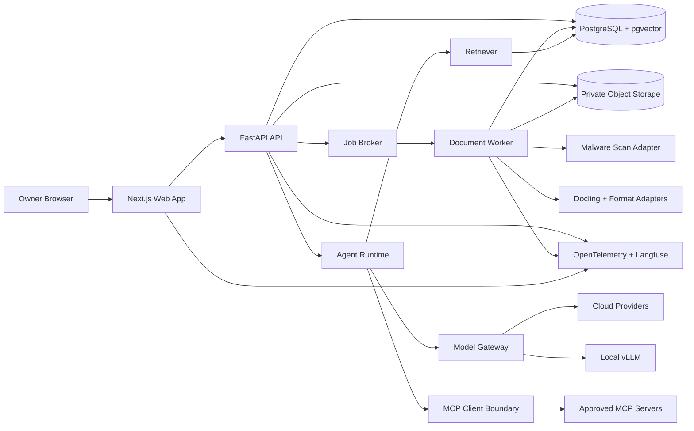
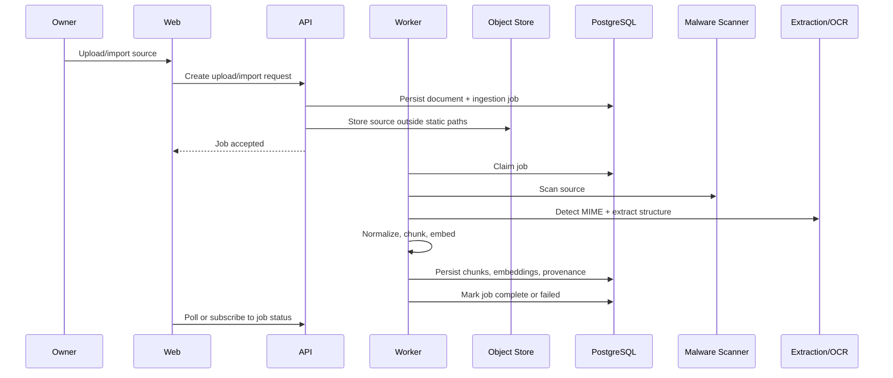
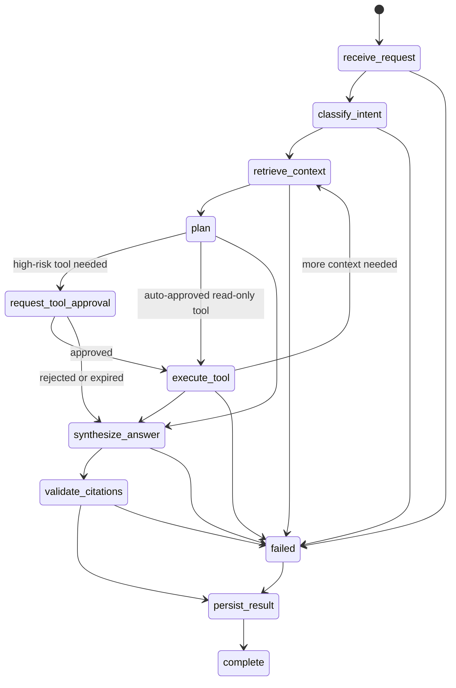

# Loomi-Brain Architecture

## Reader And Action

Reader: a backend, frontend, AI platform, or security engineer evaluating the project design.

Post-read action: understand the system boundaries, data flow, API contract, technology choices, and initial dependency baseline well enough to implement Phase 1.

## Current Repository State

The repository started empty except for agent metadata directories with no files inside them. Git metadata was initialized during discovery, but branch metadata writes are restricted in this environment, so branch renaming is deferred.

Phase 1 now contains a runnable monorepo foundation:

- Next.js web app shell for the single-owner workspace.
- FastAPI API with liveness, readiness, request IDs, trace IDs, structured logs, CORS allowlist, security headers, session endpoints, and a protected document list endpoint.
- Backend-owned local owner authentication with seeded credentials, server-side session records, hashed session tokens, HttpOnly SameSite cookies, CSRF tokens for authenticated mutations, session revocation, and audit events.
- SQLAlchemy async database layer and Alembic migration for the Phase 1 base schema.
- Worker service skeleton with a long-running development mode for Docker Compose.
- Docker Compose services for PostgreSQL with pgvector, Redis, API, worker, web, and optional storage, malware scan, and observability profiles.
- CI workflow for frozen installs, formatting, linting, type checks, tests, frontend build, PostgreSQL migration check, local security checks, dependency audit, and container builds.

Phase 2 adds the first complete knowledge ingestion slice:

- Owner-scoped document upload, list, detail, preview, retry, re-index, delete, tag, and ingestion-job APIs.
- Private local object storage adapter using random server-generated object keys.
- Upload size/count limits, content MIME detection, extension allowlist, safe display filename normalization, fake/required scanner modes, parser output limits, Office archive limits, PDF page limits, and image pixel limits.
- Parser protocols and builtin adapters for PDF, DOCX, PPTX, Markdown, text, HTML, CSV, and common OCR image formats. Docling is pinned as an optional adapter behind the same interface.
- Deterministic chunker, fake embedding provider, stable chunk IDs, JSON vector persistence, and provenance metadata.
- Knowledge Library web route at `/knowledge` using the contracts package typed client.
- OpenAPI snapshot and TypeScript API client in `packages/contracts`.

Phase 3 adds hybrid search and cited chat:

- Lexical, semantic, and hybrid retrieval endpoints under `/api/v1/search`.
- Retrieval service interfaces for retrievers, rerankers, and context assembly.
- PostgreSQL FTS and pgvector migration path with SQLite deterministic fallbacks for CI.
- Provider-neutral model gateway with mock, OpenAI-compatible, OpenAI, Anthropic, Gemini, and vLLM adapters.
- Persistent conversations, messages, message citations, agent runs, and agent events.
- SSE streamed response execution with cancellation, retry, source preview, provider health, and feedback endpoints.
- Search and chat web routes using sanitized Markdown rendering and citation/source panels.

Phase 4 adds the controlled agent runtime:

- Internal `AgentRuntime` and `Tool` protocols with a custom explicit state machine.
- Persisted agent runs, append-only events, tool calls, approvals, policy decisions,
  usage, latency, sanitized input/output, retries, cancellation, and audit metadata.
- First-party tools for knowledge search, document metadata, source excerpts, safe
  calculation, and approval-required draft-note staging.
- Owner approval records bound to exact tool ID, run ID, risk class, expiration, and
  canonical argument hash.
- Agent Run Inspector web route at `/runs` with timeline, tools, approvals, usage,
  errors, cancel, retry, approve, and deny controls.

## Architecture Overview

Loomi-Brain uses a monorepo with separate web, API, worker, shared UI, shared contracts, infrastructure, tests, scripts, and documentation modules.



## Technology Baseline

This baseline was checked on 2026-07-28 against primary package sources and local tooling. Lockfiles will be generated before implementation claims are made.

### Local Environment

- Node.js: 24.12.0, compatible with Next.js and ESLint requirements.
- npm: 11.13.0.
- Corepack: 0.34.5.
- pnpm: missing locally; use Corepack in setup.
- Python: 3.10.12 locally; uv resolved CPython 3.14.3 for the initial API and worker lockfiles.
- uv: 0.11.3.
- Docker: 29.6.2.
- GNU Make: 4.3.

### Frontend

- Next.js 16.2.12 with App Router.
- React 19.2.x and React DOM matched to React.
- TypeScript 6.0.3 for the first lockfile because TypeScript 7.0.2 is latest but is outside the current supported peer range of the TypeScript ESLint stack.
- Tailwind CSS 4.3.3.
- shadcn/ui patterns over Radix primitives.
- TanStack Query 5.101.4.
- React Hook Form 7.83.0.
- Zod 4.4.3.
- ESLint 9.39.5 for the first lockfile because the Next lint plugin set has not yet accepted ESLint 10 peers.
- Prettier 3.9.6.
- Playwright for end-to-end and route-level UI verification.

### Backend And Worker

- Python 3.14.3 target for v1 after the initial API and worker dependency solve succeeded with uv.
- FastAPI 0.140.7.
- Pydantic 2.13.4; ignore 2.14.0 alpha until stable.
- SQLAlchemy 2.0.51; ignore 2.1 beta until stable.
- Alembic 1.18.5.
- asyncpg 0.31.0.
- pgvector Python 0.5.0.
- Docling 2.115.0 for document extraction.
- Dramatiq 2.2.0 with Redis for background jobs. Its LGPL license is acceptable for a dynamically linked application dependency but must be documented in dependency notices.
- Ruff, mypy or pyright, pytest, pytest-asyncio, Hypothesis, and Testcontainers.

### AI, Observability, And Integrations

- Phase 4 uses a custom minimal explicit runtime behind an internal `AgentRuntime`
  protocol. PydanticAI 2.19.0 and LangGraph 1.2.9 were reviewed and remain future
  adapter candidates.
- LiteLLM 1.93.0 behind an internal adapter; ignore pre-release versions.
- Langfuse 4.14.1 for LLM observability.
- OpenTelemetry SDK 1.44.0 for traces, metrics, and logs.
- MCP protocol support based on the latest published specification during Phase 0: stdio and Streamable HTTP, with HTTP+SSE only as backward compatibility.

## Module Boundaries

### Web

The web app owns UI composition, routing, accessibility, streaming presentation, form validation, local interaction state, and API-client usage. It does not store provider secrets, bypass owner authorization, directly connect to MCP servers, or execute tools.

### API

The API owns authentication, owner authorization, request validation, OpenAPI generation, service orchestration, streaming agent execution, approvals, provider configuration, signed upload/download URLs, and audit events.

### Worker

The worker owns ingestion jobs, file scanning, media detection, extraction, OCR orchestration, normalization, chunking, embedding, indexing, and job progress events.

### Contracts

Contracts hold generated TypeScript clients and shared schema artifacts. Backend OpenAPI remains the source of truth for HTTP contracts.

### UI Package

The UI package holds reusable, accessible components such as AppShell, Sidebar, CommandPalette, DataTable, ChatMessage, CitationChip, SourcePreview, ToolCallCard, ApprovalCard, RunTimeline, UploadDropzone, SkillEditor, MCPServerCard, and JsonViewer with redaction.

## API Design

All API routes are versioned under `/api/v1`. The same-repo frontend is the first caller, but the API is designed as a durable contract.

### Cross-Cutting Rules

- Authentication: secure, HttpOnly, SameSite cookies for browser sessions.
- Authorization: owner check for every private resource in service and data access layers.
- Error shape: Problem Details compatible envelope with `type`, `title`, `status`, `detail`, `code`, `request_id`, `trace_id`, and optional `errors`.
- Pagination: cursor pagination by default with a hard `limit` cap.
- Idempotency: required on side-effecting retries such as uploads, delete requests, ingestion retry, exports, tool execution, and chat run creation.
- Streaming: Server-Sent Events for assistant events unless a future workflow proves WebSockets are required.
- OpenAPI: generated by FastAPI and used to generate the frontend client.

### Endpoint Groups

- Health: liveness, readiness, dependency health, version. Phase 1 implements liveness and database-backed readiness.
- Session: current owner, login, logout, session list, session revoke, CSRF token. Phase 1 implements local owner login, current owner, logout, session list, and session revoke.
- Documents: upload intent, upload complete, list, detail, versions, preview, re-index, delete. Phase 1 implements an owner-scoped list endpoint to verify the authorization boundary.
- Ingestion jobs: list, detail, retry, cancel, event stream.
- Search: query with lexical, semantic, hybrid modes and filters.
- Conversations: list, create, detail, messages, delete/export.
- Agent execution: run creation, event stream, list/filter, cancel, retry, run detail.
- Approvals: pending approvals, approve, deny, expire by policy, cancel by run cancellation.
- Providers: configurations, model capabilities, health checks.
- Skills: drafts, publish, archive, disable, versions, tests, dry-run, import/export.
- MCP: servers, capabilities, policies, health checks, audit log.
- Observability: trace summaries, run metrics, ingestion metrics, feedback.
- Evaluations: datasets, runs, results.
- Data rights: export, deletion, backup metadata.

## Data Model

Use UUID-compatible string primary keys, timezone-aware timestamps, created/updated/deleted metadata, ownership columns on sensitive tables, and explicit constraints. PostgreSQL-native UUID columns can replace the string representation in a later migration if the portability tradeoff stops being useful.

Core tables:

- users
- owner_settings
- auth_accounts
- sessions
- provider_configurations
- documents
- document_versions
- ingestion_jobs
- chunks
- embeddings
- tags
- document_tags
- collections
- collection_documents
- conversations
- messages
- message_citations
- agent_runs
- agent_events
- tool_calls
- approvals
- skills
- skill_versions
- skill_tests
- mcp_servers
- mcp_capabilities
- audit_events
- user_feedback
- evaluation_datasets
- evaluation_runs
- evaluation_results

The first pgvector index uses cosine distance. Phase 3 adds a PostgreSQL `vector(16)` column for the current deterministic embedding dimension and an HNSW cosine index. This is sized for synthetic/demo scale and must be migrated when production embedding dimensions change. SQLite tests continue to use JSON vectors and deterministic Python cosine scoring.

Phase 1 enables the pgvector extension on PostgreSQL but stores embedding vectors as JSON until the ingestion phase defines the embedding dimensions and index strategy. That keeps the initial migration runnable while avoiding a premature vector schema.

Phase 2 persists deterministic embedding vectors as JSON with dimension/model/version/checksum metadata. This keeps local tests deterministic and avoids mixing vector dimensions before retrieval evaluation defines the pgvector schema. The migration adds ingestion progress, timing, cancellation, stage logs, chunk stable IDs, text hashes, chunker version, embedding version, vector checksum, parser metadata, and collection uniqueness indexes.

Phase 3 keeps JSON vectors for deterministic tests and mirrors them into pgvector on PostgreSQL. Lexical search uses a GIN index over `to_tsvector('english', chunks.text)`. Hybrid rank fusion uses reciprocal rank fusion before duplicate suppression and token-budget context assembly.

Phase 4 completes the runtime fields on `agent_runs`, `agent_events`, `tool_calls`,
`approvals`, and `audit_events`. The runtime stores sanitized owner requests, allowed
tools, limits, policy decisions, canonical argument hashes, redacted tool arguments and
results, approval state, retry counts, usage/cost estimates, latency, trace IDs, and
terminal errors.

## Ingestion Pipeline



Pipeline stages:

1. Upload or import.
2. Validate.
3. Malware scan.
4. Detect media type from content.
5. Extract text and structure.
6. OCR when needed.
7. Normalize.
8. Remove or mark repeated boilerplate.
9. Split into semantically meaningful chunks.
10. Generate embeddings.
11. Index lexical and vector representations.
12. Persist provenance.
13. Mark ingestion status.
14. Emit metrics and trace events.

Phase 2 implements file upload ingestion only. URL import remains out of scope until the SSRF controls in the threat model are implemented. The current background execution path is FastAPI background tasks: requests return accepted job IDs and the processing stages update persistent job state. A Redis-backed worker claim loop remains the intended durable queue path for later hardening.

## Retrieval And Cited Answer Flow

1. Receive question and filters.
2. Validate query bounds and owner-scoped filters.
3. Retrieve lexical and vector candidates.
4. Fuse rankings with reciprocal rank fusion for hybrid mode.
5. Apply minimum score, source diversity, duplicate suppression, and token budget.
6. Label selected chunks as untrusted evidence with opaque citation IDs.
7. Synthesize answer through a provider-neutral adapter.
8. Validate citations against selected context.
9. Stream answer, citations, metrics, warnings, and trace IDs.
10. Persist conversation, messages, run state, run events, citations, and feedback hooks.

## Agent State Machine



Runtime controls:

- Max steps and max tool calls per run.
- Request timeout and cancellation.
- Per-run token and cost budgets.
- Idempotency keys for side effects.
- Durable event records.
- Retry only transient failures.
- Explicit untrusted-content boundaries.

## MCP Architecture

Loomi-Brain is an MCP client, not an unrestricted proxy. The model never receives direct arbitrary MCP access.

MCP servers are configured by the owner through registry records. Stdio servers use administrator-defined executable and argument templates, a minimal environment, restricted working directories, output-size caps, and no shell metacharacter expansion. Streamable HTTP servers require allowed origins, authentication where supported, size limits, timeouts, and protocol-version handling.

Tool risk classes:

- read-only
- local mutation
- external mutation
- credential-sensitive
- destructive

External mutation, credential-sensitive, and destructive tools require explicit owner confirmation.

## Deployment Profiles

### Fully Local

Docker Compose runs web, API, worker, PostgreSQL with pgvector, Redis, optional MinIO, optional Langfuse, optional OpenTelemetry collector, optional ClamAV, and optional vLLM. Services bind to localhost by default.

### Cloud

Frontend runs on Vercel. API and worker run on a long-running container platform. PostgreSQL with pgvector runs on a managed service such as Neon. Object storage uses a private S3-compatible bucket. Provider secrets stay in server-side secret storage.

### Private/Hybrid

The first secure hybrid release prefers running the full stack on a private machine and accessing it through Tailscale. Exposing local vLLM publicly is explicitly out of scope.

## Proposed Directory Tree

```text
loomi-brain/
  apps/
    web/
    api/
    worker/
  packages/
    ui/
    contracts/
    config/
  infra/
    docker/
    migrations/
    deployment/
  docs/
    decisions/
  scripts/
  tests/
  .github/
    workflows/
```

## Architectural Invariants

- API is the authorization boundary.
- Provider secrets are never shipped to the browser.
- Retrieved content, tool output, model output, MCP metadata, and skill manifests are untrusted.
- Published skill versions are immutable.
- Side-effecting operations are idempotent and audited.
- Observability is useful when available and non-fatal when unavailable.
- Mock providers and synthetic fixtures are first-class test paths.
