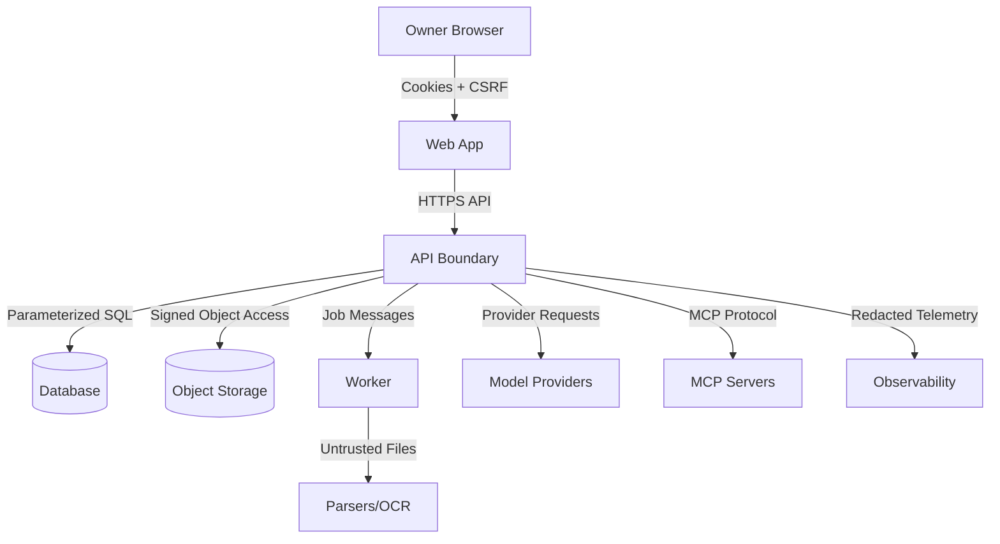

# Loomi-Brain Threat Model

## Reader And Action

Reader: a security reviewer, maintainer, or contributor implementing a new surface.

Post-read action: identify the major threats, required controls, and security tests that must be preserved while building the system.

## Scope

This threat model covers the initial single-owner application: web app, API, worker, database, object storage, document ingestion, retrieval, chat, agent runtime, provider gateway, MCP client, skills, observability, local deployment, cloud deployment, and private/hybrid deployment.

This document remains the baseline design threat model. Phase 1 now has authentication and schema code, while ingestion, retrieval, agents, MCP, skills, and observability still require code-level security reviews as those surfaces land.

Phase 2 implements the first upload and ingestion surface. Uploaded files, filenames, extracted text, parser metadata, previews, chunks, and embeddings are untrusted. Implemented controls include owner-scoped routes, CSRF on upload/retry/reindex/cancel/delete/tag mutations, stream size limits, extension and content MIME allowlists, dangerous extension rejection, random private object keys, filename display normalization, fake/required scanner modes, parser output limits, Office archive limits, PDF page limits, image pixel limits, deterministic fake OCR/embeddings, escaped previews, no ordinary logging of document text/binaries, and complete source/chunk/embedding deletion for document delete.

Phase 1 adds enough application code for the authentication boundary to be reviewed and tested. The implemented controls are:

- Public registration is absent.
- A local owner can be seeded through the backend.
- Password verification is backend-owned.
- Browser sessions use server-side records and hashed session tokens.
- Session cookies are HttpOnly and SameSite.
- Cookie-authenticated mutations require a CSRF token.
- Logout and explicit session revocation mark sessions revoked server-side.
- Document listing requires an owner session and filters by owner on the server.
- API responses include request and trace identifiers.
- API middleware adds security headers.
- Production settings reject the default local password and insecure cookies.

Residual Phase 1 risks:

- Local development credentials are not suitable for remote deployment.
- Rate limiting is not implemented until hardening.
- Upload, parsing, model, MCP, and skill attack surfaces are still design-only because those features start in later phases.
- Optional object storage, malware scanning, and observability services are present as local Compose profiles but are not yet integrated into request handling.

Residual Phase 2 risks:

- Background processing is API-process background tasks, not a durable Redis worker claim loop yet.
- Local fake scanner is not malware protection; production must require a real scanner adapter before remote use.
- Builtin extraction is intentionally narrow. Docling is pinned as an optional adapter but not the default until worker isolation and resource controls are hardened.
- Rate limiting and quota enforcement are still limited to size/count bounds.
- URL ingestion is deferred because SSRF protections are not implemented.
- Embeddings are JSON vectors with deterministic fake values, not pgvector-native production embeddings.

## Trust Boundaries

Trusted components are the owner-controlled server process, database access layer, migrations, static frontend bundle, and configured secrets. Untrusted inputs include browser requests, uploaded files, imported URLs, document text, document metadata, extracted chunks, embeddings from untrusted content, retrieved passages, user-provided prompts, model outputs, MCP server metadata, MCP responses, tool outputs, skill manifests, webhook-like callbacks, environment variables, and dependency packages.

## Assets

- Owner account and sessions.
- Provider API keys and secret references.
- Personal documents and derived chunks.
- Embeddings and retrieval indexes.
- Conversations and citations.
- Agent runs, tool calls, approvals, traces, and feedback.
- MCP server definitions and policy.
- Skills, skill versions, tests, and execution history.
- Backups and exports.
- Audit logs and security-relevant telemetry.

## STRIDE Analysis

### Spoofing

Threats:

- Attacker logs in as owner through weak setup, session theft, OAuth misconfiguration, or redirect abuse.
- Browser or script calls API without a valid owner session.
- MCP server impersonates a trusted server after configuration drift.

Controls:

- Disable public registration.
- Normalize and match the exact owner identity.
- Use secure, HttpOnly, SameSite cookies.
- Enforce CSRF protection on cookie-authenticated mutations.
- Require strict redirect URI validation.
- Store sessions server-side with revocation.
- Require owner checks in service and data layers.
- Persist MCP server identity, transport, executable template or URL, fingerprint where practical, and approval policy.

Tests:

- Unauthenticated access fails.
- Non-owner identity fails.
- Revoked and expired sessions fail.
- Unsafe redirects fail.
- Unknown MCP server cannot execute tools.

### Tampering

Threats:

- Uploaded files mutate parsing behavior or overwrite paths.
- Client tampers with document IDs, owner IDs, tool policy, or provider configuration.
- MCP metadata or tool output modifies system policy.
- Skill manifest injects executable code or excessive template expansion.
- Database records are corrupted by non-idempotent retries.

Controls:

- Generate random object keys and safe display filenames.
- Store files outside executable/static directories.
- Ignore client-supplied owner IDs.
- Use parameterized database access and strict schemas.
- Use idempotency keys for side effects.
- Treat MCP metadata, tool output, retrieved content, model output, and skill manifests as untrusted.
- Validate skill manifests with JSON Schema.
- Prohibit arbitrary Python, JavaScript, shell, SQL, Jinja expressions, and package installation in skills.
- Make published skill versions immutable.

Tests:

- Path traversal filenames are neutralized.
- Object ownership tampering returns 403 or 404.
- Malformed skill manifests fail.
- Forbidden template features fail.
- Retried side-effecting requests do not duplicate records.
- Upload retry/re-index idempotency keys return the existing job instead of duplicating work.

### Repudiation

Threats:

- Owner or attacker cannot determine who approved a tool call.
- Sensitive changes lack traceable audit events.
- Logs are missing request IDs or trace IDs.

Controls:

- Persist audit events for login, logout, session revocation, provider changes, document deletion, tool approval, MCP changes, skill publishing, data export, and destructive actions.
- Include request IDs and trace IDs in errors and audit events.
- Record approval decision, policy version, risk class, tool name, redacted arguments, and expiration.
- Retain telemetry according to explicit retention settings.

Tests:

- Sensitive mutation creates an audit event.
- Tool approval decisions are visible in run history.
- Error responses include request and trace identifiers.

### Information Disclosure

Threats:

- API key, authorization header, cookie, or provider secret leaks to browser, logs, traces, tool output, or exports.
- Document text leaks to observability by default.
- Cross-resource IDOR exposes private documents or conversations.
- Markdown rendering allows XSS or unsafe links.
- Model output fabricates citations to inaccessible content.

Controls:

- Provider secrets server-side only.
- Redact secrets and sensitive headers before logs and telemetry export.
- Make prompt/response capture opt-in by environment.
- Never export document binaries or unrestricted personal text to telemetry.
- Enforce owner checks before loading private data.
- Render Markdown with raw HTML disabled and sanitized links.
- Validate citations against selected context before returning a grounded answer.

Tests:

- Browser bundles contain no provider secrets.
- Incorrect owner resource access fails.
- Malicious Markdown/XSS payloads are sanitized.
- Sensitive output redaction works.
- Citation fabrication fails validation.

### Denial Of Service

Threats:

- Oversized upload, decompression bomb, OCR-heavy image, recursive parser behavior, or large CSV exhausts worker resources.
- Search, chat, or tool endpoints are spammed.
- Model streaming runs forever.
- MCP server emits excessive output.
- URL importer downloads huge responses or follows redirect loops.

Controls:

- Upload size, page count, decompression, parser timeout, and response-size limits.
- Rate limits on authentication, upload, chat, retrieval, and tool endpoints.
- Worker CPU, memory, runtime, and output caps where deployment permits.
- Request-level timeout and cancellation.
- Max steps, max tool calls, token budgets, and cost budgets.
- URL importer redirect, byte, and timeout limits.
- MCP output truncation and timeout limits.

Tests:

- Oversized and bomb-like uploads fail safely.
- Rate-limited endpoints return 429 with retry hints.
- Model stream cancellation persists a canceled state.
- MCP response-size cap truncates and audits.
- Unsupported executable uploads, MIME mismatches, malformed Office archives, scanner rejection, scanner unavailable in required mode, and oversized uploads fail safely.

### Elevation Of Privilege

Threats:

- Prompt injection causes model to call a forbidden tool.
- Indirect prompt injection from documents or MCP results overrides system policy.
- MCP stdio command injection runs arbitrary shell commands.
- Skill manifest grants undeclared tools or expands templates into policy changes.
- Frontend-only authorization lets a caller bypass UI checks.

Controls:

- Runtime policy is code and database state, not model text.
- Retrieved content and tool output are quoted as untrusted data with lower priority than system instructions.
- Tool execution checks allowlists and approval policy server-side.
- Stdio MCP uses executable and argument templates, not browser-provided shell strings.
- Reject shell metacharacter expansion.
- Use minimal environment and restricted working directory for stdio MCP.
- API validates authorization even when frontend hides controls.

Tests:

- Prompt-injection document cannot gain tool authority.
- Non-allowlisted MCP tool call is blocked.
- Forbidden shell metacharacters in stdio configuration fail validation.
- Skill with undeclared or forbidden tools cannot publish or execute.

## Required Security Controls

### Authentication And Authorization

- Owner-only setup.
- Secure cookies.
- CSRF defense.
- Session revocation.
- Backend ownership checks.
- Optional row-level security where practical.
- No long-lived auth tokens in localStorage.

Phase 1 security tests cover unauthenticated document access, owner login, bad-password rejection, CSRF rejection on logout, logout revocation, explicit session revocation, and authenticated owner-scoped document listing.

Phase 2 security tests cover unauthenticated upload, missing CSRF, path traversal filename neutralization, executable/unsupported upload rejection, MIME mismatch rejection, malformed Office rejection, malicious HTML preview sanitization, prompt-injection text treated as data, scanner rejection, required scanner unavailable fail-closed behavior, oversized upload rejection, idempotent re-index, and deletion removing derived data.

### Upload And Parsing

- Content-based MIME detection.
- ClamAV-compatible malware scanning adapter.
- Safe filenames and random object keys.
- Non-executable storage.
- Parser and OCR resource limits.
- Failure recovery and retry.

### URL Import

- Allow only HTTP and HTTPS.
- Resolve and validate DNS before connect.
- Block loopback, link-local, private, multicast, metadata, and reserved ranges.
- Validate every redirect.
- Limit redirects, response bytes, and timeout.
- Mitigate DNS rebinding as far as practical.

### MCP

- Registry-driven configuration.
- Per-server and per-tool allowlists.
- Tool risk classes.
- Explicit approval for external mutation, credential-sensitive, and destructive calls.
- Result sanitization and truncation.
- No arbitrary shell command strings from browser.

### Skills

- JSON Schema validation.
- Semantic versioning.
- Draft, published, archived, disabled states.
- Immutable published versions.
- Sandboxed logic-limited templates.
- No arbitrary code execution or dynamic package installation.

### Observability

- Correlation IDs across web, API, worker, agent, and provider calls.
- Configurable prompt/response capture.
- Redaction before export.
- Graceful degradation when observability service is down.
- Sampling and retention controls.

### Deployment

- TLS in cloud.
- Managed encryption at rest where available.
- Non-root containers.
- Read-only filesystem where practical.
- Dropped Linux capabilities.
- Health checks and resource limits.
- Explicit egress controls where deployable.
- Backup and restore documentation.

## Security Test Matrix

The test suite must include:

- Unauthenticated access.
- Incorrect owner access.
- CSRF-sensitive mutations.
- Malicious Markdown and XSS payloads.
- Path traversal filenames.
- MIME mismatch.
- Oversized uploads.
- Decompression-bomb-like uploads.
- SSRF attempts against localhost, RFC1918 ranges, IPv6 local addresses, and metadata endpoints.
- Prompt injection in documents.
- MCP tool calls not on the allowlist.
- Malformed skill manifests.
- Forbidden template features.
- Sensitive output redaction.
- Rate limiting.
- Expired or revoked sessions.
- No citation fabrication.
- Tool approval enforcement.
- Max-step enforcement.
- Provider timeout and failure handling.
- Streaming cancellation.

## Residual Risks

- Local deployments depend on the owner's host security.
- Parser sandboxes vary by operating system and container runtime.
- LiteLLM and model provider behavior can change quickly; adapter contract tests are mandatory.
- LLM cost estimation is approximate and provider-specific.
- A single-owner product can still leak data if owner credentials or local machine are compromised.
- Embeddings may encode sensitive content; they must be treated as private data.

## Review Triggers

Run a focused security review whenever implementation changes:

- Authentication or session handling.
- Authorization logic.
- Upload, parsing, OCR, URL import, or filesystem access.
- Provider secrets or telemetry.
- Tool execution or MCP transports.
- Skill manifest parsing or templating.
- Markdown rendering.
- Database migrations for sensitive records.
