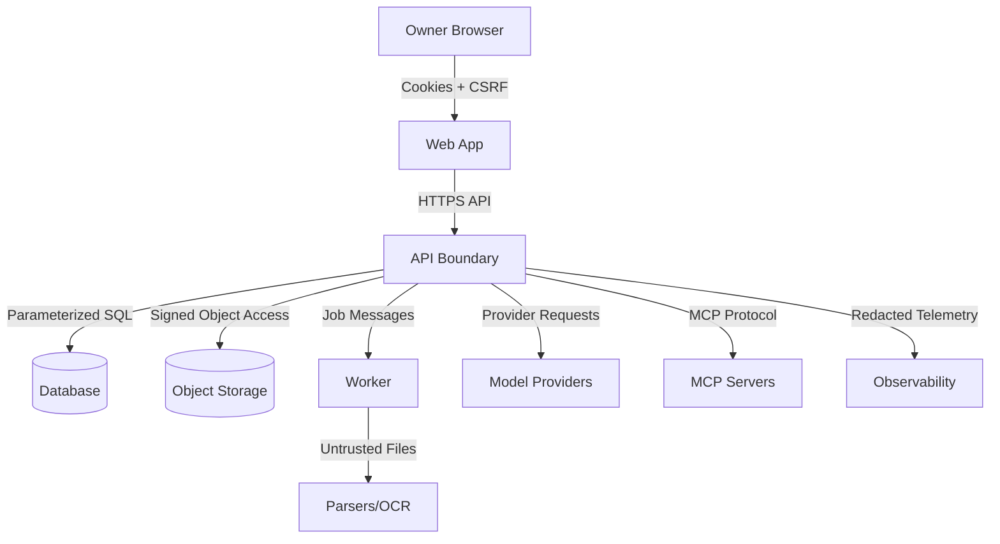

# Loomi-Brain Threat Model

## Reader And Action

Reader: a security reviewer, maintainer, or contributor implementing a new surface.

Post-read action: identify the major threats, required controls, and security tests that must be preserved while building the system.

## Scope

This threat model covers the initial single-owner application: web app, API, worker, database, object storage, document ingestion, retrieval, chat, agent runtime, provider gateway, MCP client, skills, observability, local deployment, cloud deployment, and private/hybrid deployment.

This document remains the baseline design threat model. Phase 1 now has authentication and schema code, while ingestion, retrieval, agents, MCP, skills, and observability still require code-level security reviews as those surfaces land.

Phase 2 implements the first upload and ingestion surface. Uploaded files, filenames, extracted text, parser metadata, previews, chunks, and embeddings are untrusted. Implemented controls include owner-scoped routes, CSRF on upload/retry/reindex/cancel/delete/tag mutations, stream size limits, extension and content MIME allowlists, dangerous extension rejection, random private object keys, filename display normalization, fake/required scanner modes, parser output limits, Office archive limits, PDF page limits, image pixel limits, deterministic fake OCR/embeddings, escaped previews, no ordinary logging of document text/binaries, and complete source/chunk/embedding deletion for document delete.

Phase 1 adds enough application code for the authentication boundary to be reviewed and tested. The implemented controls are:

- Public registration is absent.
- A local owner can be seeded through the backend.
- Password verification is backend-owned.
- Browser sessions use server-side records and hashed session tokens.
- Session cookies are HttpOnly and SameSite.
- Cookie-authenticated mutations require a CSRF token.
- Logout and explicit session revocation mark sessions revoked server-side.
- Document listing requires an owner session and filters by owner on the server.
- API responses include request and trace identifiers.
- API middleware adds security headers.
- Production settings reject the default local password and insecure cookies.

Residual Phase 1 risks:

- Local development credentials are not suitable for remote deployment.
- Rate limiting is not implemented until hardening.
- Upload, parsing, model, MCP, and skill attack surfaces are still design-only because those features start in later phases.
- Optional object storage, malware scanning, and observability services are present as local Compose profiles but are not yet integrated into request handling.

Residual Phase 2 risks:

- Background processing is API-process background tasks, not a durable Redis worker claim loop yet.
- Local fake scanner is not malware protection; production must require a real scanner adapter before remote use.
- Builtin extraction is intentionally narrow. Docling is pinned as an optional adapter but not the default until worker isolation and resource controls are hardened.
- Rate limiting and quota enforcement are still limited to size/count bounds.
- URL ingestion is deferred because SSRF protections are not implemented.
- Embeddings are JSON vectors with deterministic fake values, not pgvector-native production embeddings.

Phase 3 implements the first retrieval and cited-chat surface. Retrieved candidates, selected context, provider responses, generated Markdown, citation IDs, and source previews are untrusted. Implemented controls include owner-scoped search/conversation/source/provider/feedback endpoints, bounded query and result sizes, server-side provider secrets, deterministic mock provider for CI, untrusted-evidence prompt labels, citation validation against selected chunks, fabricated citation removal warnings, sanitized React Markdown rendering with raw HTML disabled, unsafe link filtering, persisted cancellation state, and no vector exposure through public endpoints.

Residual Phase 3 risks:

- Prompt injection is mitigated but not solved perfectly.
- Semantic retrieval uses deterministic local embeddings for CI; production embedding quality needs a larger evaluation dataset.
- Rate limiting remains a later hardening item.
- Real provider streaming is normalized through adapters but CI covers mock/provider-error paths rather than live paid providers.

Phase 4 implements the first controlled tool surface. Owner requests, retrieved
context, model/tool metadata, tool arguments, and tool results remain untrusted.
Implemented controls include per-run tool allowlists, server-side tool argument
validation, exact canonical argument hashes, approval-required local mutation tooling,
single-use owner approval records, denial and argument-change invalidation, forbidden
tool request blocking, safe calculator AST evaluation, redacted/truncated tool results,
bounded steps/tool calls/token/cost metadata, persisted cancellation, and audit events
for runtime and approval decisions.

Residual Phase 4 risks:

- Planning is deterministic and narrow; future model-driven tool proposals need adapter
  contract tests before live provider use.
- `notes.create_draft` stages output in the tool-call result only until a durable notes
  feature exists.
- Recovery after restart is event/history based; there is no background resume worker yet.

Phase 5 implements the first observability and evaluation surface. Telemetry spans,
trace links, prompt metadata, usage/cost reports, retrieval diagnostics, evaluation
reports, and owner feedback metadata are owner-only. Implemented controls include
allowlist-based telemetry attributes, header/query redaction helpers, secret-pattern
redaction, maximum field sizes, disabled/local-only/exporter modes, production content
capture rejection, production sampling caps, prompt ID/version recording instead of
prompt text, best-effort exporter failure handling, bounded date ranges, pagination, and
owner-only observability endpoints.

Residual Phase 5 risks:

- Local JSONL retention is guidance-based; automated pruning is deferred.
- OpenTelemetry SDK and Langfuse SDK dependencies remain optional; the current exporter
  emits OpenTelemetry-shaped payloads and can post to OTLP/Langfuse endpoints when
  configured.
- The owner-facing dashboard summarizes product-level signals, not every vendor trace
  feature.

## Trust Boundaries

Trusted components are the owner-controlled server process, database access layer, migrations, static frontend bundle, and configured secrets. Untrusted inputs include browser requests, uploaded files, imported URLs, document text, document metadata, extracted chunks, embeddings from untrusted content, retrieved passages, user-provided prompts, model outputs, MCP server metadata, MCP responses, tool outputs, skill manifests, webhook-like callbacks, environment variables, and dependency packages.

## Assets

- Owner account and sessions.
- Provider API keys and secret references.
- Personal documents and derived chunks.
- Embeddings and retrieval indexes.
- Conversations and citations.
- Agent runs, tool calls, approvals, traces, and feedback.
- MCP server definitions and policy.
- Skills, skill versions, tests, and execution history.
- Backups and exports.
- Audit logs and security-relevant telemetry.

## STRIDE Analysis

### Spoofing

Threats:

- Attacker logs in as owner through weak setup, session theft, OAuth misconfiguration, or redirect abuse.
- Browser or script calls API without a valid owner session.
- MCP server impersonates a trusted server after configuration drift.

Controls:

- Disable public registration.
- Normalize and match the exact owner identity.
- Use secure, HttpOnly, SameSite cookies.
- Enforce CSRF protection on cookie-authenticated mutations.
- Require strict redirect URI validation.
- Store sessions server-side with revocation.
- Require owner checks in service and data layers.
- Persist MCP server identity, transport, executable template or URL, fingerprint where practical, and approval policy.

Tests:

- Unauthenticated access fails.
- Non-owner identity fails.
- Revoked and expired sessions fail.
- Unsafe redirects fail.
- Unknown MCP server cannot execute tools.

### Tampering

Threats:

- Uploaded files mutate parsing behavior or overwrite paths.
- Client tampers with document IDs, owner IDs, tool policy, or provider configuration.
- MCP metadata or tool output modifies system policy.
- Skill manifest injects executable code or excessive template expansion.
- Database records are corrupted by non-idempotent retries.

Controls:

- Generate random object keys and safe display filenames.
- Store files outside executable/static directories.
- Ignore client-supplied owner IDs.
- Use parameterized database access and strict schemas.
- Use idempotency keys for side effects.
- Treat MCP metadata, tool output, retrieved content, model output, and skill manifests as untrusted.
- Validate skill manifests with JSON Schema.
- Prohibit arbitrary Python, JavaScript, shell, SQL, Jinja expressions, and package installation in skills.
- Make published skill versions immutable.

Tests:

- Path traversal filenames are neutralized.
- Object ownership tampering returns 403 or 404.
- Malformed skill manifests fail.
- Forbidden template features fail.
- Retried side-effecting requests do not duplicate records.
- Upload retry/re-index idempotency keys return the existing job instead of duplicating work.

### Repudiation

Threats:

- Owner or attacker cannot determine who approved a tool call.
- Sensitive changes lack traceable audit events.
- Logs are missing request IDs or trace IDs.

Controls:

- Persist audit events for login, logout, session revocation, provider changes, document deletion, tool approval, MCP changes, skill publishing, data export, and destructive actions.
- Include request IDs and trace IDs in errors and audit events.
- Record approval decision, policy version, risk class, tool name, redacted arguments, and expiration.
- Retain telemetry according to explicit retention settings.

Tests:

- Sensitive mutation creates an audit event.
- Tool approval decisions are visible in run history.
- Error responses include request and trace identifiers.

### Information Disclosure

Threats:

- API key, authorization header, cookie, or provider secret leaks to browser, logs, traces, tool output, or exports.
- Document text leaks to observability by default.
- Cross-resource IDOR exposes private documents or conversations.
- Markdown rendering allows XSS or unsafe links.
- Model output fabricates citations to inaccessible content.

Controls:

- Provider secrets server-side only.
- Redact secrets and sensitive headers before logs and telemetry export.
- Make prompt/response capture opt-in by environment.
- Never export document binaries or unrestricted personal text to telemetry.
- Use telemetry allowlists, field-size limits, secret-pattern redaction, and production
  content-capture rejection before persistence or export.
- Enforce owner checks before loading private data.
- Render Markdown with raw HTML disabled and sanitized links.
- Validate citations against selected context before returning a grounded answer.

Tests:

- Browser bundles contain no provider secrets.
- Incorrect owner resource access fails.
- Malicious Markdown/XSS payloads are sanitized.
- Sensitive output redaction works.
- Citation fabrication fails validation.

### Denial Of Service

Threats:

- Oversized upload, decompression bomb, OCR-heavy image, recursive parser behavior, or large CSV exhausts worker resources.
- Search, chat, or tool endpoints are spammed.
- Model streaming runs forever.
- MCP server emits excessive output.
- URL importer downloads huge responses or follows redirect loops.

Controls:

- Upload size, page count, decompression, parser timeout, and response-size limits.
- Rate limits on authentication, upload, chat, retrieval, and tool endpoints.
- Worker CPU, memory, runtime, and output caps where deployment permits.
- Request-level timeout and cancellation.
- Max steps, max tool calls, token budgets, and cost budgets.
- URL importer redirect, byte, and timeout limits.
- MCP output truncation and timeout limits.

Tests:

- Oversized and bomb-like uploads fail safely.
- Rate-limited endpoints return 429 with retry hints.
- Model stream cancellation persists a canceled state.
- MCP response-size cap truncates and audits.
- Unsupported executable uploads, MIME mismatches, malformed Office archives, scanner rejection, scanner unavailable in required mode, and oversized uploads fail safely.

### Elevation Of Privilege

Threats:

- Prompt injection causes model to call a forbidden tool.
- Indirect prompt injection from documents or MCP results overrides system policy.
- MCP stdio command injection runs arbitrary shell commands.
- Skill manifest grants undeclared tools or expands templates into policy changes.
- Frontend-only authorization lets a caller bypass UI checks.

Controls:

- Runtime policy is code and database state, not model text.
- Retrieved content and tool output are quoted as untrusted data with lower priority than system instructions.
- Tool execution checks allowlists and approval policy server-side.
- Stdio MCP uses executable and argument templates, not browser-provided shell strings.
- Reject shell metacharacter expansion.
- Use minimal environment and restricted working directory for stdio MCP.
- API validates authorization even when frontend hides controls.

Tests:

- Prompt-injection document cannot gain tool authority.
- Non-allowlisted MCP tool call is blocked.
- Forbidden shell metacharacters in stdio configuration fail validation.
- Skill with undeclared or forbidden tools cannot publish or execute.

## Required Security Controls

### Authentication And Authorization

- Owner-only setup.
- Secure cookies.
- CSRF defense.
- Session revocation.
- Backend ownership checks.
- Optional row-level security where practical.
- No long-lived auth tokens in localStorage.

Phase 1 security tests cover unauthenticated document access, owner login, bad-password rejection, CSRF rejection on logout, logout revocation, explicit session revocation, and authenticated owner-scoped document listing.

Phase 2 security tests cover unauthenticated upload, missing CSRF, path traversal filename neutralization, executable/unsupported upload rejection, MIME mismatch rejection, malformed Office rejection, malicious HTML preview sanitization, prompt-injection text treated as data, scanner rejection, required scanner unavailable fail-closed behavior, oversized upload rejection, idempotent re-index, and deletion removing derived data.

Phase 3 security tests cover authenticated search/chat/provider/feedback routes, prompt-injection evidence treated as untrusted, no-answer behavior, fabricated citation rejection, source chunk lookup through owner scope, provider health without secret exposure, and cancellation state updates.

Phase 4 security tests cover legal and illegal runtime transitions, read-only tool
execution, approval-required tool pause/resume, denial preventing execution,
argument-change invalidation, max-step and max-tool limits, cancellation,
idempotent run creation, prompt-injected forbidden tool requests, and secret-like
inline redaction in persisted run history.

### Upload And Parsing

- Content-based MIME detection.
- ClamAV-compatible malware scanning adapter.
- Safe filenames and random object keys.
- Non-executable storage.
- Parser and OCR resource limits.
- Failure recovery and retry.

### URL Import

- Allow only HTTP and HTTPS.
- Resolve and validate DNS before connect.
- Block loopback, link-local, private, multicast, metadata, and reserved ranges.
- Validate every redirect.
- Limit redirects, response bytes, and timeout.
- Mitigate DNS rebinding as far as practical.

### MCP

- Registry-driven configuration.
- Per-server and per-tool allowlists.
- Tool risk classes.
- Explicit approval for external mutation, credential-sensitive, and destructive calls.
- Result sanitization and truncation.
- No arbitrary shell command strings from browser.

Phase 6 implemented controls:

- Browser requests can select only server-side stdio templates; executable paths
  and shell command strings are not accepted.
- Streamable HTTP endpoints are validated before use. Loomi blocks URL userinfo,
  non-HTTP(S) schemes, redirects, loopback/private/link-local/metadata/multicast/
  reserved destinations, and HTTPS downgrade outside local/test mode.
- MCP metadata is sanitized and cached as untrusted display data. Discovered
  capabilities remain disabled until the owner explicitly enables each tool.
- Tool approvals include the stored schema hash, so schema changes invalidate
  stale approval.
- Stdio subprocesses receive a minimal environment, fixed arguments, startup and
  execution timeouts, bounded stdout/stderr, and process-group termination on
  timeout.
- MCP execution writes audit events and sanitized telemetry spans.

Residual risks:

- The built-in stdio controls are not a complete sandbox. Production deployments
  should run stdio servers under separate users/containers with seccomp/AppArmor,
  read-only filesystems, CPU/memory limits, and explicit egress policy.
- Remote server trust is still administrative. A malicious but allowlisted remote
  server can return deceptive data; the agent runtime must continue treating all
  results as untrusted tool data.

### Agent Runtime

- Internal runtime protocol and code-owned state machine.
- Per-run tool allowlist.
- Server-side tool schema validation.
- Risk classification and approval policy independent of model text.
- Canonical argument hashes for approval binding.
- Single-use approvals with expiration.
- Redaction and truncation before persistence/UI.
- Audit events for policy decisions and tool execution.

### Skills

- JSON Schema validation.
- Semantic versioning.
- Draft, published, archived, disabled states.
- Immutable published versions.
- Sandboxed logic-limited templates.
- No arbitrary code execution or dynamic package installation.

Phase 7 implemented controls:

- Skill manifests use strict Pydantic models with unknown-field rejection,
  normalized names, SemVer validation, canonical JSON, and SHA-256 checksums.
- The supported JSON Schema subset is validated before persistence and before
  owner input/output validation. Unsupported schema keywords are rejected.
- Templates support only bounded dictionary-path placeholders such as
  `{{ input.question }}`. Loops, filters, calls, imports, internal names,
  undefined variables, recursive expansion, unsafe tokens, excessive template
  size, and excessive rendered size are rejected.
- Published versions are immutable. Updates require a draft clone with a new
  version.
- Skill execution loads the exact published version, validates input,
  intersects skill tools with server runtime/MCP policy, applies effective
  limits, and then uses the Phase 4 agent runtime.
- Skills cannot weaken global approval, authorization, budget, model, or MCP
  policy. Risky tools still require runtime approval.
- Dry runs and deterministic tests do not call external models or tools.
- Imports are JSON-only in Phase 7, size-limited, validated completely,
  reviewed with requested permissions, and persisted as drafts only. Import
  never publishes or enables tools.
- Exports omit secrets, credential references, provider configuration, approval
  data, and hidden server policy. Tests are exported only when explicitly
  requested.
- Skill lifecycle, validation, publish, import, export, dry-run, test, and
  execution operations write audit events.

Residual Phase 7 risks:

- The JSON Schema implementation intentionally supports a small subset. Richer
  schema features need a new validator decision and tests.
- YAML import is deferred. If added, it must use a safe loader and reject custom
  tags before enabling the API.
- Template logic is intentionally minimal. Owners needing conditionals or loops
  must model that as explicit manifest structure until a future bounded design is
  reviewed.

Phase 8 deployment and hardening controls:

- API and web responses include CSP, frame blocking, referrer, permissions, MIME
  sniffing, and production HSTS headers.
- API validates trusted hosts and rejects oversized requests before route
  handling.
- Login failures are rate-limited for single-node deployments.
- Production settings reject default owner credentials, insecure cookies,
  wildcard CORS/trusted hosts, disabled scanner policy, telemetry content
  capture, excessive telemetry sampling, and private-network MCP egress.
- App containers run as non-root users, drop Linux capabilities, use
  no-new-privileges, and use read-only root filesystems where practical.
- Compose binds public ports to localhost by default and separates edge/backend
  networks.
- Backup, restore verification, owner export, guarded local deletion, and DR
  smoke scripts are provided.
- CodeQL, Trivy filesystem/container scans, secret/config scanning, SBOM
  artifact generation, Dependabot, and manual release packaging workflows are
  configured.

Residual Phase 8 risks:

- Login throttling is in-memory and must be replaced with shared storage before
  horizontally scaling API containers.
- Browser E2E and accessibility suites are still release blockers.
- Optional service images are configurable for operator pinning; not every
  optional profile is pinned to a digest by default.
- Cloud deployment, managed backup restore, and private connector behavior must
  be verified by the owner before production claims.

Phase 9 voice controls:

- Microphone capture starts only after explicit owner action; no always-on listening and
  no wake-word detection are implemented.
- Voice routes are owner-only and CSRF-protected for mutations.
- Audio uploads enforce MIME allowlists, max size, max duration metadata, provider
  timeouts, rate limits, and safe provider-error normalization.
- Raw audio is not persisted by default. If retention is enabled, retained audio is
  stored as a private object and can be deleted through the owner-only audio deletion
  endpoint.
- Cloud STT/TTS remains disabled unless the owner explicitly enables it and server-side
  credentials are configured.
- Transcripts are owner input, reviewed by default, and submitted through the existing
  cited-chat path. Voice cannot approve tool calls, MCP invocations, skill executions,
  destructive actions, or credential-sensitive operations.
- TTS reads only visible assistant answer text and rejects secret-like text.

Residual Phase 9 risks:

- Browser microphone permissions and device selection are browser-controlled.
- Audio duration is enforced from client metadata in this phase; precise server-side
  media-duration parsing is deferred.
- Realtime speech-to-speech and local wake-word detection are out of scope.
- Browser E2E must mock microphone and playback APIs unless the environment supports
  real media devices.

### Observability

- Correlation IDs across web, API, worker, agent, and provider calls.
- Configurable prompt/response capture.
- Redaction before export.
- Graceful degradation when observability service is down.
- Sampling and retention controls.

### Deployment

- TLS in cloud.
- Managed encryption at rest where available.
- Non-root containers.
- Read-only filesystem where practical.
- Dropped Linux capabilities.
- Health checks and resource limits.
- Explicit egress controls where deployable.
- Backup and restore documentation.

## Security Test Matrix

The test suite must include:

- Unauthenticated access.
- Incorrect owner access.
- CSRF-sensitive mutations.
- Malicious Markdown and XSS payloads.
- Path traversal filenames.
- MIME mismatch.
- Oversized uploads.
- Decompression-bomb-like uploads.
- SSRF attempts against localhost, RFC1918 ranges, IPv6 local addresses, and metadata endpoints.
- Prompt injection in documents.
- MCP tool calls not on the allowlist.
- Malformed skill manifests.
- Forbidden template features.
- Sensitive output redaction.
- Rate limiting.
- Expired or revoked sessions.
- No citation fabrication.
- Tool approval enforcement.
- Voice transcription auth, MIME, size, duration, retention, deletion, cloud-disabled,
  mock STT/TTS, and TTS voice allowlist enforcement.
- Max-step enforcement.
- Provider timeout and failure handling.
- Streaming cancellation.

## Residual Risks

- Local deployments depend on the owner's host security.
- Parser sandboxes vary by operating system and container runtime.
- LiteLLM and model provider behavior can change quickly; adapter contract tests are mandatory.
- LLM cost estimation is approximate and provider-specific.
- A single-owner product can still leak data if owner credentials or local machine are compromised.
- Embeddings may encode sensitive content; they must be treated as private data.

## Review Triggers

Run a focused security review whenever implementation changes:

- Authentication or session handling.
- Authorization logic.
- Upload, parsing, OCR, URL import, or filesystem access.
- Provider secrets or telemetry.
- Tool execution or MCP transports.
- Skill manifest parsing or templating.
- Markdown rendering.
- Database migrations for sensitive records.
